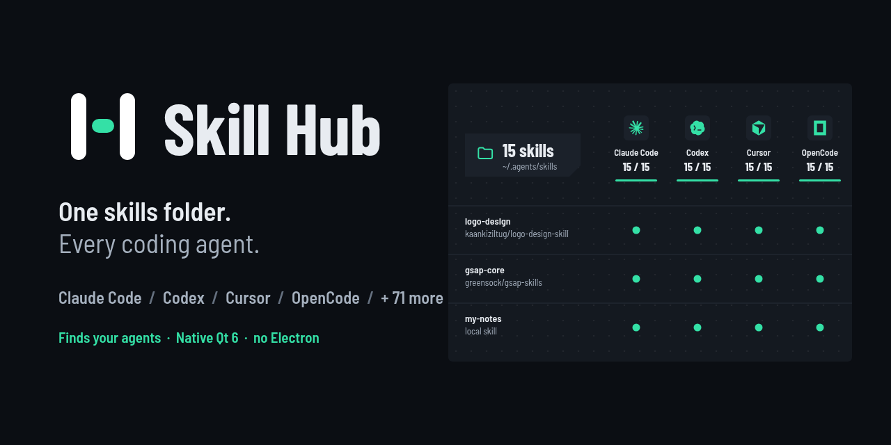
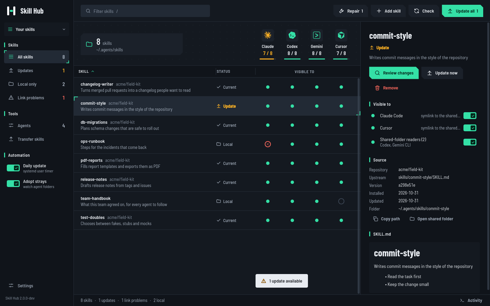
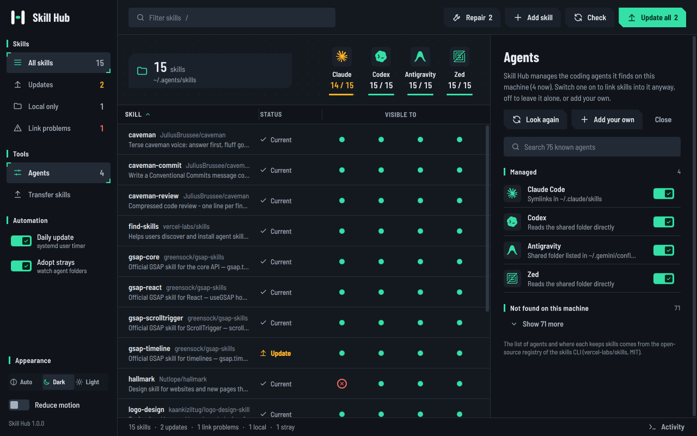
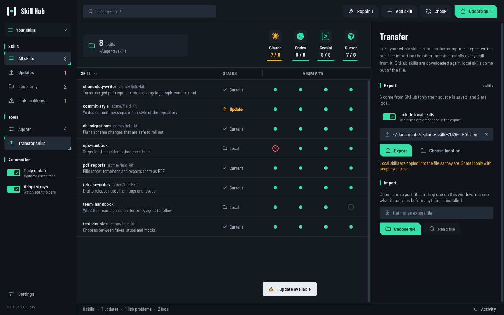
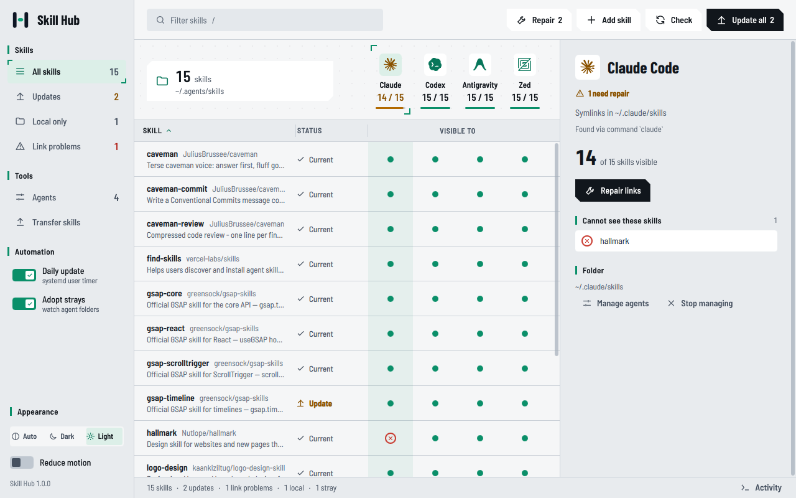
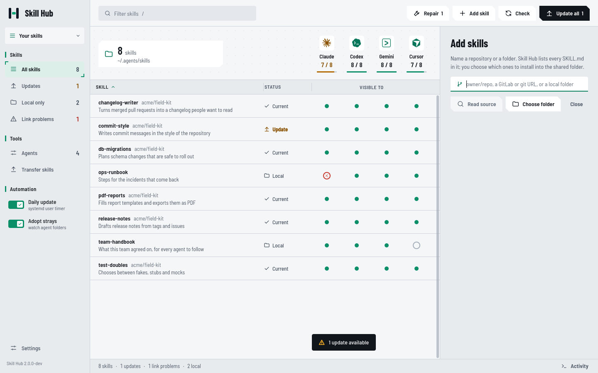

<p align="center">
  
</p>

<p align="center">
  <a href="https://github.com/nimonht/skillhub/actions/workflows/ci.yml"></a>
  <a href="LICENSE"></a>
  
  
  
</p>

**Skill Hub** keeps **one** folder of agent skills and shares it with every coding agent on your machine. It looks at what
is installed (Claude Code, Codex, Cursor, OpenCode, Gemini CLI, Antigravity, Zed and about 70 more), works out how each one
finds skills, and wires them all to the same folder. It is a native **Qt 6 / C++** app (a GUI *and* a CLI in one small
binary of a few MB, no Electron, no Node, no web view) that installs skills from GitHub, keeps them current, shows which agent can
actually see which skill, moves your whole skill set to another computer with one file, and stops skills from spreading
into a different folder per agent again.

<p align="center">
  
</p>

## The problem

Every agent has its own skills directory (`~/.claude/skills`, `~/.cursor/skills`, `~/.config/opencode/skills`, ...). Install a
skill for three agents and you own three copies that drift apart, update separately and clutter your disk. Skill Hub turns
that into one directory plus a few symlinks, and tells you the moment something drifts.

## What it does

- **Finds your agents.** It checks for each known agent's command and config folder, shows what it found and how it was
  found, and adjusts the whole app to it: columns, links, the stray watcher. Install an agent while the app is open and it
  appears when you come back to the window. Turn any agent on or off, or add your own, in **Agents**.
- **One canonical folder**: `~/.agents/skills/`. Agents that read it themselves (Codex, Zed, Gemini CLI, ...) need nothing
  written. Agents with their own folder get one relative symlink per skill. Antigravity is pointed at the folder through its
  documented `skills.json`. Skill Hub never writes into an agent it does not manage.
- **Sees the whole picture**: one column per managed agent above the list, one port per skill in it. A glance tells you which
  agent can't see which skill; click a column header to inspect that agent and repair it.
- **Transfer between machines**: *Export* writes one JSON file with every skill (GitHub skills as their source, local skills
  with their files); *Import* on the other machine shows what is inside, then downloads and installs everything. Drag the
  file onto the window, or use `skillhub export` / `skillhub import`.
- **Adopts the mess**: finds real skill folders sitting in agent directories, moves them into the shared folder, sets
  identical duplicates aside and keeps conflicting copies instead of overwriting anything.
- **Install from GitHub**: name a repository, tick the skills you want from its list, done.
- **Updates**: compares each skill's folder hash with its upstream repository (git tree SHA), updates one or all, keeps
  the previous three versions, and can run daily through a systemd user timer.
- **Stays tidy**: an optional systemd path watcher pulls a skill dropped into an agent folder back into the shared one.
- **Dark and light themes** that follow your system, keyboard-first, readable (contrast is checked in CI).
- **Compatible with `npx skills`**: reads and writes the same `~/.agents/.skill-lock.json` (v3) lock file.

<table>
  <tr>
    <td width="50%"></td>
    <td width="50%"></td>
  </tr>
  <tr>
    <td align="center"><sub>Agents it found, how, and one switch each. 75 are known; add your own.</sub></td>
    <td align="center"><sub>Export one file, import it on another machine: preview, then install everything.</sub></td>
  </tr>
  <tr>
    <td width="50%"></td>
    <td width="50%"></td>
  </tr>
  <tr>
    <td align="center"><sub>Light theme, one agent inspected: what it can't see, and a one-click repair.</sub></td>
    <td align="center"><sub>Add from GitHub: read a repo, tick the skills you want.</sub></td>
  </tr>
</table>

<sub>Screenshots use a demo setup with a handful of public skills; two are deliberately stale and one agent link was
removed to show the states.</sub>

## Install

Packages are attached to every [release](https://github.com/nimonht/skillhub/releases/latest):

| System | Package | How |
|---|---|---|
| Debian 12 and 13, Ubuntu 25.10 and newer | `skillhub_<version>_amd64.deb` (also `arm64`) | `sudo apt install ./skillhub_*_amd64.deb` |
| Ubuntu 24.04 LTS, Linux Mint 22 | `skillhub_<version>_ubuntu24.04_amd64.deb` (also `arm64`) | `sudo apt install ./skillhub_*_ubuntu24.04_amd64.deb` |
| Fedora 43 and newer | `skillhub-<version>-1.fc43.x86_64.rpm` (also `aarch64`) | `sudo dnf install ./skillhub-*.rpm` |
| Arch, CachyOS, Manjaro | [`packaging/arch/PKGBUILD`](packaging/arch/PKGBUILD) | `cd packaging/arch && makepkg -si` |
| macOS 12 and newer (Apple silicon and Intel) | `SkillHub-<version>-macos-universal.dmg` | drag *Skill Hub* to Applications |
| Windows 10 / 11 (64-bit) | `SkillHub-<version>-windows-x64-setup.exe`, or the portable `.zip` | run the installer (per user, no administrator needed) |

`sha256sums` for every file are in `SHA256SUMS`. Verify with `sha256sum -c SHA256SUMS --ignore-missing`.

**The macOS and Windows builds are not code-signed** (that needs paid developer accounts), so the system asks you once:

- *macOS*: the first start is blocked. On macOS 15 and newer open **System Settings, Privacy & Security** and press **Open
  Anyway** next to *Skill Hub*; on older versions right-click the app and choose **Open**. Or run
  `xattr -dr com.apple.quarantine "/Applications/Skill Hub.app"` once. For the command line:
  `sudo ln -s "/Applications/Skill Hub.app/Contents/MacOS/skillhub" /usr/local/bin/skillhub`.
- *Windows*: SmartScreen says "Windows protected your PC": **More info**, then **Run anyway**. The window is `skillhub.exe`;
  `skillhub-cli.exe` is the same program for terminals and scripts (the installer can add it to your PATH).

Ubuntu 22.04 (Qt 6.2) is too old. On any other Linux, build from source. The two `.deb` flavours exist because Ubuntu 24.04
renamed its Qt libraries (`libqt6core6t64`); installing the wrong one just fails with a clear dependency error.

### Build from source

Needs Qt 6.4 or newer (Qt Quick, Quick Controls 2), `git` and a C++17 compiler.

```sh
# Arch / CachyOS / Manjaro
sudo pacman -S --needed qt6-base qt6-declarative git base-devel
# Fedora:  sudo dnf install qt6-qtbase-devel qt6-qtdeclarative-devel git-core gcc-c++ make
# Debian / Ubuntu:
#   sudo apt install qt6-base-dev qt6-declarative-dev git build-essential libgl-dev \
#        qml6-module-qtquick qml6-module-qtquick-controls qml6-module-qtquick-templates qml6-module-qtquick-shapes \
#        qml6-module-qtquick-window qml6-module-qtqml-workerscript qml6-module-qtquick-dialogs
# macOS:   Qt from https://www.qt.io or Homebrew (brew install qt), Xcode command line tools
# Windows: Qt for MSVC 2022 and Visual Studio build tools, then use "x64 Native Tools Command Prompt": qmake ..\skillhub.pro && nmake

git clone https://github.com/nimonht/skillhub.git
cd skillhub
qmake6 && make -j"$(nproc)"
make install            # Linux: installs to ~/.local  (use: qmake6 PREFIX=/usr  for a system-wide install)
```

The packages are built by [`packaging/`](packaging) (a Debian `debian/` directory, an RPM spec, an Inno Setup script and a
disk-image script) and by [`.github/workflows/release.yml`](.github/workflows/release.yml); each Linux package is installed in a
fresh container and started before it is published.

## Quick start

```sh
skillhub                   # open the window
skillhub doctor            # what is wrong? (strays, duplicates, dead links, Antigravity not wired up)
skillhub adopt             # fix it: move everything into ~/.agents/skills and relink

skillhub providers                         # which coding agents were found, and how each one sees skills
skillhub export my-skills.json             # one file with every skill, to move to another machine
skillhub import my-skills.json             # on the other machine: shows what is inside, then installs it all

skillhub add greensock/gsap-skills --all            # install every skill of a repo
skillhub add kaankiziltug/logo-design-skill --skill logo-design
skillhub track my-skill owner/repo                  # give a local skill an upstream
skillhub check                                      # fetch upstream, list updates (exit code 10 if any)
skillhub update --all                               # apply them

skillhub autoupdate on     # daily update via systemd user timer
skillhub watch on          # auto-adopt strays dropped into agent folders
```

### Keyboard

| Key | Action |
|---|---|
| `/` or `Ctrl+F` | filter skills |
| `Up` / `Down`, `Enter` | move through the list, open a skill |
| `Ctrl+N` | add skills from GitHub |
| `Ctrl+U` | check for updates |
| `Ctrl+Shift+U` | update everything |
| `F5` | refresh |
| `Ctrl+Shift+A` | manage agents |
| `Ctrl+Shift+E` | transfer skills (export / import) |
| `Ctrl+J` | show / hide the activity log |
| `Esc` | clear the filter or close the panel |

## How agents are found and wired

Skill Hub carries a catalog of coding agents that read user-level skills (generated by [`tools/gen-providers.py`](tools/gen-providers.py)
from the open registry of the [skills CLI](https://github.com/vercel-labs/skills), MIT). For each one it looks for the
agent's command and its own config folder; agents it finds are *managed*, the rest are left completely alone.

| How the agent finds skills | What Skill Hub does | Examples |
|---|---|---|
| reads `~/.agents/skills` itself | nothing to write; only its own legacy folder is scanned for strays | Codex, Zed, Cline, Gemini CLI, Droid, Pi |
| has its own skills folder | one relative symlink per skill in that folder | Claude Code, Cursor, OpenCode, Windsurf, GitHub Copilot, Goose, Kiro, ... |
| lists extra folders in a config file | adds the shared folder to the file, keeps the other entries | Antigravity (`~/.gemini/config/skills.json`) |

Detection is conservative: a common command name is not evidence, and a shared config folder is not either (Gemini CLI needs
its own files, because `~/.gemini` also belongs to Antigravity). `skillhub providers` shows what was found and why, and you can
switch any agent on or off, or add your own folder, in **Agents** (stored in `~/.config/skillhub/providers.json`).
Folders owned by the tools themselves (`~/.claude/skills/synced`, `~/.codex/skills/.system`, built-in skills, plugin caches)
are never touched.

## CLI

| Command | What it does |
|---|---|
| `skillhub` / `skillhub gui` | open the window |
| `list [--json]` | skills, source and per-agent link state |
| `doctor [--fix]` | report (and repair) strays, dead links, Antigravity config |
| `adopt` | pull strays into the shared folder, relink agents |
| `providers [--all] [--json]` | the agents found on this machine, how each was found and how it sees skills |
| `providers enable\|disable ID` | manage an agent, or leave it alone |
| `providers add LABEL DIR [--shared]` / `remove ID` | your own agent (`--shared`: it reads the shared folder itself) |
| `export [FILE] [--no-local]` | write every skill to one file; local skills are embedded unless `--no-local` |
| `import FILE [--yes] [--no-local] [--only a,b]` | show what is in an export and install it (never overwrites an installed skill) |
| `check` | fetch upstream and list available updates |
| `update --all` / `update NAME...` | apply updates (`--auto --notify` is what the timer runs) |
| `add OWNER/REPO [--skill a,b \| --all]` | install skills from a GitHub repository |
| `remove NAME` | remove a skill everywhere (a copy is kept in the backup folder) |
| `track NAME OWNER/REPO [PATH]` | set the upstream of a skill you already have |
| `autoupdate on\|off\|status` | daily update timer (systemd user unit; Linux only) |
| `watch on\|off\|status` | stray-skill watcher (systemd user path unit; Linux only) |
| `uninstall [--dry-run] [--yes] [--keep-cache]` | remove units, installed files below `$HOME` and the cache; keeps your skills |

## Uninstall

```sh
skillhub uninstall --dry-run     # show what would be removed
skillhub uninstall               # asks first; --yes skips the prompt, --keep-cache keeps ~/.cache/skillhub
```

This removes the systemd units, the files `make install` put below your home directory (binary, launcher, icons) and the
git cache. It **never** touches your skills: `~/.agents/skills`, the lock file, the agent symlinks, the Antigravity entry
and `~/.agents/.backup` all stay (delete them by hand if you want them gone). For a system-wide install use your package
manager or `sudo make uninstall`; both remove only files this project installed.

## Safety

- Nothing is deleted outright: replaced, removed and conflicting skills go to `~/.agents/.backup/` (the last three
  versions of each skill are kept).
- Skills are instructions your agents follow with your permissions. **Auto-update pulls the upstream default branch** of
  every repository you track, so only track sources you trust, or leave the timer off and run `skillhub check` yourself.
  See [SECURITY.md](SECURITY.md).
- An import file is treated as untrusted: names and paths are validated, symlinks are never created, sizes are capped, sources must be GitHub repositories, nothing is executed and installed skills are never overwritten. Skills still run with your agents' permissions, so import only files you trust. GitHub skills arrive at their latest upstream version, not necessarily the one on the other machine.
- Updates use plain `git` (HTTPS clones into `~/.cache/skillhub`); there is no telemetry and no account.

## Design

The interface is a working tool first; its visual language is inspired by *Arknights: Endfield* (smoked charcoal and paper
materials, chamfered action shapes, circles for instruments, selection by corner hooks) without using
any game asset. Colour has jobs (mint = lit/selected, amber = needs action, lime = just updated, red = broken) and every
state also carries an icon or a word. No outlined controls, no pill badges: tone steps do that job. See [DESIGN.md](DESIGN.md) for tokens and rules.

## Status and limits

- Linux is the home platform. **macOS and Windows** run the same program (window and CLI); the daily update timer and the stray watcher are systemd units, so they exist on Linux only for now. The macOS and Windows builds are tested by CI (build, command line, window rendering) but have not been used on real hardware by the author: please report what you find.
- Windows links agents' folders with symlinks when Windows allows them (Developer Mode or administrator) and with junctions otherwise, so no setting is needed.
- The catalog is as good as its source. Claude Code and Codex were tested live; Gemini CLI, Antigravity and Zed follow their documentation; for the other agents, where they read skills comes from the skills CLI registry. Report a wrong entry and it will be fixed.
- Antigravity wiring follows its documented `skills.json` mechanism; it is the least battle-tested agent here.
- GitHub repositories only (no GitLab or local-path sources yet).

## Roadmap

- [ ] Show a diff before applying an update, and one-click rollback in the GUI
- [ ] Per-agent enable/disable for a skill
- [ ] Project-level skills (`.claude/skills` in a repository), not only user-level ones
- [ ] GitLab / arbitrary git URLs and local-path sources
- [ ] Flatpak / AppImage, Homebrew cask and winget
- [ ] Daily update and stray watcher on macOS (launchd) and Windows (Task Scheduler)
- [ ] Signed macOS and Windows builds

## Contributing

Issues and pull requests are welcome, especially "agent X reads user skills from here" reports. See
[CONTRIBUTING.md](CONTRIBUTING.md).

## License and credits

[MIT](LICENSE). The logo, banner and screenshots in this repository are covered by the same license. Fonts: Barlow by
The Barlow Project Authors, SIL Open Font License 1.1 ([`fonts/OFL.txt`](fonts/OFL.txt)). Visual language inspired by the
MIT-licensed [`endfield-design`](https://github.com/Statrue/endfield-design-skill) skill; no *Arknights: Endfield* material is
included. The agent catalog is derived from the registry of [vercel-labs/skills](https://github.com/vercel-labs/skills) (MIT, Copyright (c) 2026 Vercel, Inc.; licence text in [`data/LICENSE-vercel-labs-skills`](data/LICENSE-vercel-labs-skills)). Agent marks come from [lobe-icons](https://github.com/lobehub/lobe-icons) (MIT) and [simple-icons](https://github.com/simple-icons/simple-icons) (CC0); they are the property of their owners and only identify each agent (no affiliation or endorsement). Everything third-party is listed in [NOTICE.md](NOTICE.md).
